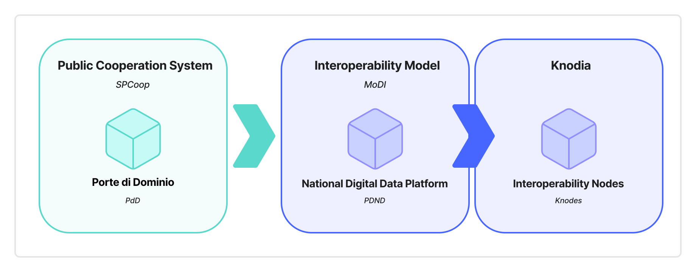

This document describes the Italian proposal to the *Interoperable Europe Board* for the experimentation of *Knodia* within the interoperability regulatory sandboxes established by the *Interoperable Europe Act*. *Knodia* is a *cross-border federation* that manages authentication and authorization for interested organizations to enable data exchange on digital channels and the integration of cross-border digital services.

*Knodia*, a *cross-border authentication and authorization framework*, is intended as a technical and administrative solution to enable digital interaction between organizations in different Member States, as well as between these organizations and the agencies of the *European Commission* and, in general, the *European Union*. The solution implements the API-first approach and is intended to ease the implementation of the once-only principle.

The *Knodia* proposal originates from the positive experience of the *Piattaforma Digitale Nazionale Dati* in Italy (*PDND*). The latter is the infrastructure for authentication and authorization of organizations – both public and private – within the *Interoperability Model* (*ModI*) for Italian public administrations.

*Knodia* is intended to comply with the current European regulatory framework on interoperability and on the protection of personal data of natural persons.

This document is organized into four distinct chapters. Specifically:

- **[Regulatory context](./02_regulatory-context.md)** considers this proposal in light of Regulation (EU) 2024/903.
- **[Objective of the proposal](./03_objective-of-the-proposal.md)** presents the objectives that this proposal intends to fulfil.
- **[Knodia as an evolution of the Italian interoperability experience](./04-00_italian-interop-intro.md)** summarizes the Italian experience on interoperability from which this proposal originates.
- **[Knodia: cross-border federated interoperability](./05-00_crossborder-federated-interop.md)** describes the elements that compose *Knodia* and how its members can implement it.
