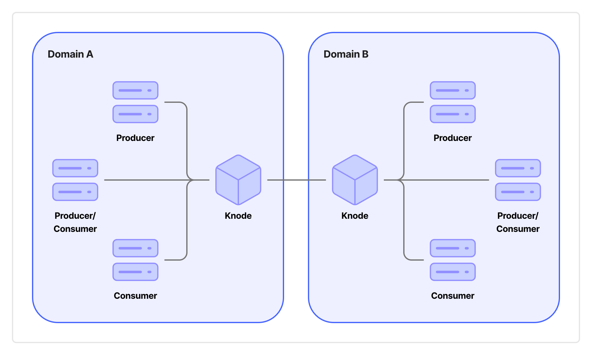

The *EIF* provides guidance to European public administrations through recommendations on how to improve the governance of their interoperability activities to:

- Foster and simplify interactions between the European Union and Member States, and among Member States themselves, to promote the sharing of data, information, and knowledge through digital processes.
- Avoid the creation of fragmented ICT islands whose interoperability is difficult to guarantee.

The objectives of the *EIF* are met through the realization of a shared infrastructure of services and information sources that enables communication between the information systems of interested parties via application programming interfaces (APIs), as expressed in Recommendation 36 of the *EIF*.

In this scenario, regardless of the specific application domain that the interaction between interested parties involves, there is the need to authenticate and authorize access to APIs and ensure their usage in compliance with the regulatory framework regarding the protection of personal data of natural persons – primarily, **Regulation (EU) 2016/679 on the protection of natural persons with regard to the processing of personal data and on the free movement of such data, and repealing Directive 95/46/EC** [1[^1]] (*GDPR*). This need aligns with the *interoperability agreements* between organizations in the provision of a European public service, mentioned in Recommendation 26 of the *EIF*.

[^1]: [https://eur-lex.europa.eu/legal-content/EN/TXT/?uri=CELEX:32016R0679](https://eur-lex.europa.eu/legal-content/EN/TXT/?uri=CELEX:32016R0679)

The present proposal, within the framework of the *Interoperable Europe Act* and specifically the instrument of *interoperability regulatory sandboxes*, proposes to establish a technical-administrative framework, hereinafter named *Knodia*, that, at a cross-border level, manages authentication and authorization for access to APIs by the organizations involved (constituting a cross-border federation).

The definition of *Knodia*, which capitalizes on the Italian experience of the *Piattaforma Digitale Nazionale Dati* (*PDND*), pursues the following objectives:

- Ensure the identification of organizations participating in the ecosystem (*Confederate Organizations*) and guarantee the assignment of *attributes* to them.
- Allow *Confederate Organizations* to make APIs available for access to data and services for which the organization itself is the authoritative source (*Producers*).
- Allow *Producers* to limit *Confederate Organizations* that can request access to their APIs based on the *attributes* the latter possess.
- Identify a process by which potential *Consumers* request access to APIs from *Producers*, adaptable to the regulatory frameworks of Member States where needed.
- Allow *Consumers* to declare, in compliance with the *GDPR* and any applicable Member State laws, the lawfulness of the processing of data they access via API.

*Knodia* as a whole constitutes the digital ecosystem involving:

- *Producer Confederate Organizations*: the organizations that make APIs available for access to data for which they are the authoritative source.
- *Consumer Confederate Organizations*: the organizations that, to perform their activities pursuant to current legislation, access the APIs made available by the Producers.
- *Interoperability Nodes* (hereinafter, *Knodes*): the entities that manage a domain by identifying a set of *Confederate Organizations* and providing services to them to operate within the ecosystem.

In the digital ecosystem constituted by *Knodia*:

- A *Confederate Organization* can be simultaneously both a *Producer* and a *Consumer*.
- *Producer*-*Consumer* interactions always occur between two *Confederate Organizations* belonging to distinct domains.

The proposed cross-border federation realized by *Knodia* ensures that:

- The attribution of responsibilities to the subjects involved in the functioning of the ecosystem is certain.
- APIs made available by *Producers* are published on the *Cross-Border E-Service Catalogue* of the *Knode* on which the *Producer* is identified.
- Access to APIs occurs securely upon completion of actions and declarations made by *Consumers*, and upon (implicit or explicit) acceptance by *Producers*.
- Interaction occurs directly between *Producers* and *Consumers*, in synchronous or asynchronous modes, without intermediation components that can be potential single points of failure.
- A technical architecture is defined for the components necessary to implement the ecosystem.
- Open standards define the communication protocols used by the ecosystem components.
- Templates for APIs and declarations of lawfulness of personal data processing are available to simplify usage by *Confederate Organizations*.
- Both human-oriented and machine-to-machine interfaces are available to let *Confederate Organizations* use the functionality provided by *Knodes*.
- The necessary tools are available for *Confederate Organizations* to deposit on the *Knodes* the cryptographic material required to secure interactions, in public key or X.509 certificate formats.
- *Producers* can request *Consumers* of their APIs proof of possession of the cryptographic material deposited by the latter on the *Knodes*.
- The *Knodes* provide functionality useful to notify interested *Consumers* of changes to data held by the Producers.

This proposal will be supplemented by the preparation of a prototype of the application components necessary to realize *Knodia*, which will be made available to subjects interested in verifying its functionality.
