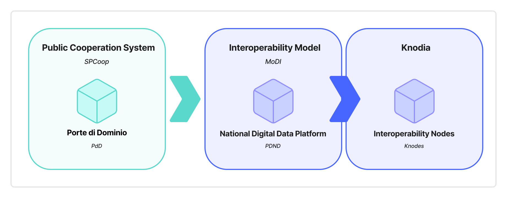

---
layout:
  navigation:
    prev: false
---

This document describes the Italian proposal to the Interoperable Europe Board for the experimentation of Knodia within the interoperability regulatory sandboxes established by the Interoperable Europe Act. Knodia is a cross-border federation that manages authentication and authorization for interested organizations to enable data exchange on digital channels and the integration of cross-border digital services.

The Knodia proposal originates from the positive experience of the National Digital Data Platform (PDND) in Italy. The latter is the infrastructure for authentication and authorization of organizations – both public and private – within the Interoperability Model of Italian public administrations.

Knodia is intended to comply with the current European regulatory framework on interoperability and on the protection of personal data of natural persons.
