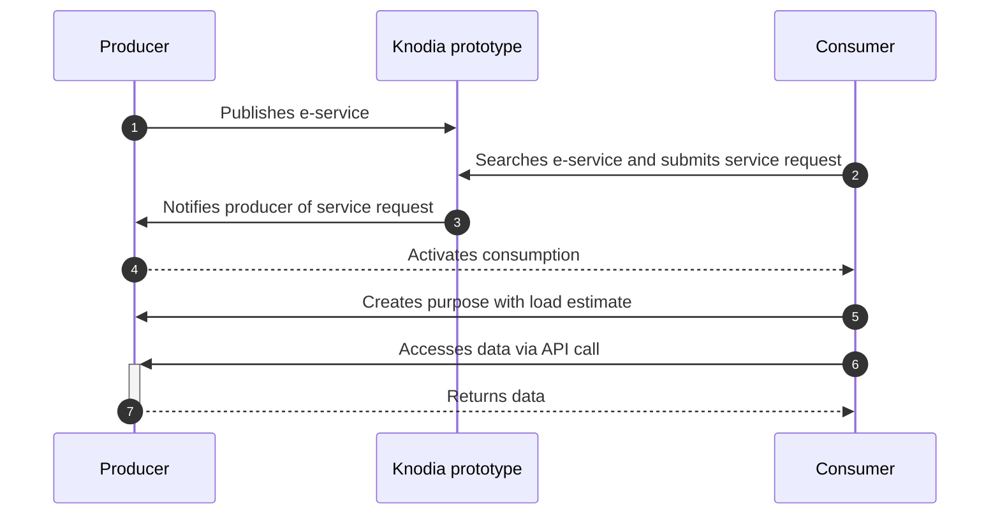

## Ecosystem and Role of Knodes

Cross-border interoperability is an ecosystem composed of components, protocols, and standards. **Knodes** are the enabling platforms at the heart of this ecosystem, enabling the publication and use of **Cross-Border E-Services**.

## Steps for sharing data via Knodes

1. **Registration**
**One-time registration** on a Knode

2. **Check the catalogs**
Log in to the platform and **check the Cross-Border E-Services already available** in the **Knode Catalogs** to access the data as a Knodia Consumer.

3. **Develop a Cross-Border E-Service**
Write an **API** to make data available to other parties as a Knodia Producer.

4. **Validate Vouchers**
Add a **verification mechanism** to your API to verify the **legitimacy and validity** of **vouchers** presented by data requesters. The voucher is valid only if **issued by the Knode** where you registered, **currently valid**, and **linked to the correct resource**.

5. **Publishing a Cross-Border E-Service**
Publish the API on the **Catalog Knode** where you registered as a **Cross-Border E-Service**, including all the **contextual and supporting information** necessary for its use.

## Basic producer/consumer flow

Below is a **simplified flow** providing an overview of how the platform works. Some steps are explored in detail in specific sections.

In the sequence diagram with Knodia prototype we mean the set of two Knodes that constitute the same.

## Knodia Producer Flow

1. A party wishing to produce a **Cross-Border E-Service** can create and manage it through the **Knode** where they are registered.

2. Once published, the **Cross-Border E-Service** becomes available in the **Knode Catalogs**, where it can be viewed in use mode.

3. Interested **Knodia Consumers**, if they meet the producer's minimum requirements (attributes), can submit a agreement request.

4. The Knodia Producer can review and manage these agreement requests.

5. After approval, the Knodia Consumer must declare their purpose statement and begin using the **Cross-Border E-Service**.

## Knodia Consumer Flow

1. A party wishing to use a **Cross-Border E-Service** can consult the **Knode Catalogs**, through the **Knode** where they are registered, to view the available ones.

2. If they meet the minimum requirements, they can submit a agreement request, which will be reviewed by the **Knodia Producer**.

3. Once the agreement request is approved and active, the **Knodia Consumer** must define the purpose, specifying:

    - Data access and processing details.
    - Load estimate, i.e., the expected number of daily API calls to the **Knodia Producer**.

4. When purpose is active, the **Knodia Consumer** can finalize the technical integration** to **obtain a voucher** from **Knodia Producer's Knode** and access the API.