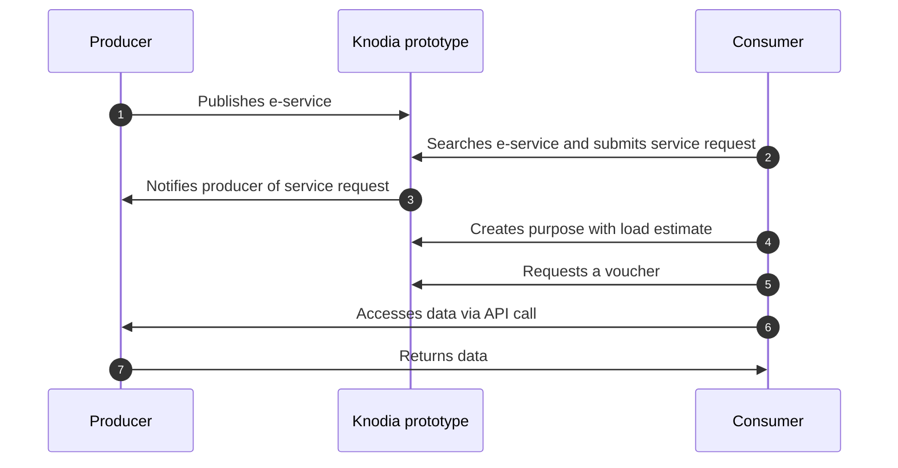

## Ecosystem and Role of Knodes

Cross-border interoperability is an ecosystem composed of components, protocols, and standards. **Knodes** are the enabling platforms at the heart of this ecosystem, ensuring the publication and use of **Cross-Border E-Services**.

## Steps for sharing data via Knodes

1. **Onboarding**
**One-time registration** on a **Knode**, where the registering entity is hereinafter referred to as:

    - A **Consumer**, when wishing to consume a **Cross-Border E-Service**.
    - A **Producer**, when wishing to produce a **Cross-Border E-Service**.

    During onboarding on the **Knode**, parties are assigned the Attributes that characterize them.

    In the **Knodia Prototype**, the list of available **Attributes** is provided as an example; in real **Knodia** implementations, the list of **Attributes** is defined collaboratively among the **Knodes** participating in the federation.

2. **Check the catalogue**
Log in to the **Knode** where onboarding took place, and **check the Cross-Border E-Services already available** in the **Knode Catalogue** to consume them as a **Consumer**.

3. **Develop a Cross-Border E-Service**
Write an API to make data available to other parties as a **Producer**.

4. **Validate Vouchers**
Add a **verification mechanism** to your API to verify the **legitimacy and validity** of **vouchers** presented by data requesters. A voucher is valid only if **issued by the Knode** where onboarding took place, **currently valid**, and **linked to the API**.

5. **Publishing a Cross-Border E-Service**
Publish the API on the **Knode Catalogue** where onboarding took place as a **Cross-Border E-Service**, including all **contextual and supporting information** necessary for its use.

## Basic producer/consumer flow

Below is a **simplified flow** providing an overview of how **Knodia** works. 

In this sequence diagram, the **Knodia prototype** refers to the set of two Knodes that constitute the infrastructure.

## Producer Flow

- A party wishing to produce a **Cross-Border E-Service** can create and manage it through the **Knode** where onboarding took place.

- Once published, the **Cross-Border E-Service** becomes available in the **Knode Catalogues** of all **Knodes**, where it can be viewed in consumption mode.

- Interested **Consumers** can submit an agreement request if they meet the producer's minimum requirements (attributes).

- The **Producer** can review and manage these agreement requests.

- After approval, the **Consumer** must declare their purposes to start using the **Cross-Border E-Service**.

## Consumer Flow

- A party wishing to use a **Cross-Border E-Service** can consult the **Knode Catalogue** through the **Knode** where onboarding took place to view those available.

- If they meet the minimum requirements, they can submit an agreement request, which will be reviewed by the **Producer**.

- Once the agreement request is approved, the **Consumer** must define the purpose, specifying:

    - The legal basis for access and how the received data will be treated (legal compliance).
    - The load estimate, i.e., the expected number of daily API calls to the **Knodia Producer**.

- When the purpose is active, the **Consumer** can finalize the technical integration to **obtain a voucher** from the **Knodia Producer's Knode** and access the API.
