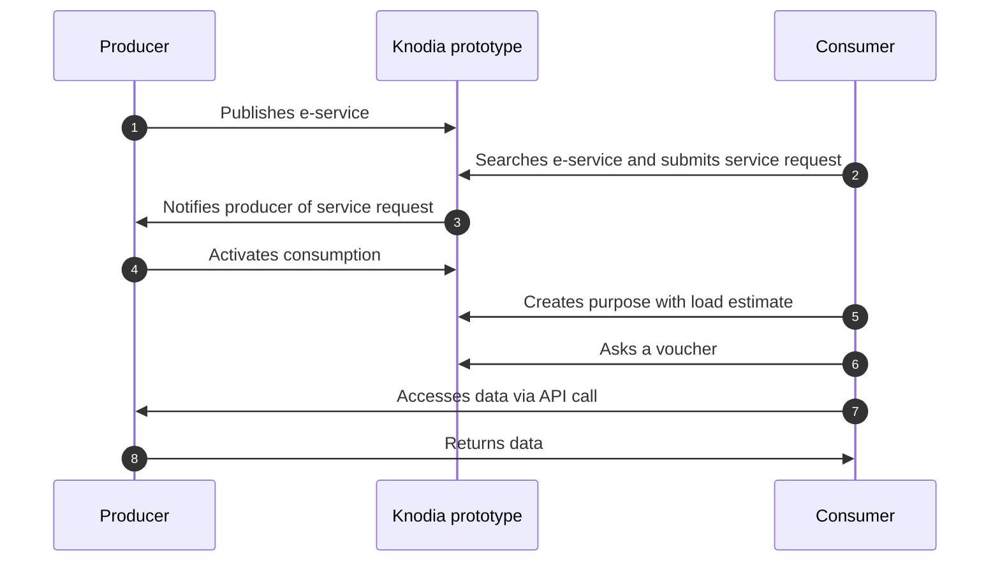

## Ecosystem and Role of Knodes

Cross-border interoperability is an ecosystem composed of components, protocols, and standards. **Knodes** are the enabling platforms, at the heart of this ecosystem, ensure the publication and use of **Cross-Border E-Services**.

## Steps for sharing data via Knodes

1. **Onboarding**
**One-time registration** on a **Knode**, hereinafter referred to as:

    - **Consumer Knode**, when the subject wishes to consume a **Cross-Border E-Service**;
    - **Producer Knode**, when the subject wishes to produce a **Cross-Border E-Service**.

2. **Check the catalogue**
Log in to the **Knode** where the onboarding took place, and **check the Cross-Border E-Services already available** in the **Knode Catalogue** to consuming as a **Consumer**.

3. **Develop a Cross-Border E-Service**
Write an API to make data available to other parties as a **Producer**.

4. **Validate Vouchers**
Add a **verification mechanism** to your API to verify the **legitimacy and validity** of **vouchers** presented by data requesters. The voucher is valid only if **issued by the Knode**  where the onboarding took place, **currently valid**, and **linked to the API**.

5. **Publishing a Cross-Border E-Service**
Publish the API on the **Knode Catalogue** where the onboarding took place as a **Cross-Border E-Service**, including all the **contextual and supporting information** necessary for its use.

## Basic producer/consumer flow

Below is a **simplified flow** providing an overview of how the **Knodia** works. 

In the sequence diagram with **Knodia prototype** we mean the set of two Knodes that constitute the same.

## Producer Flow

1. A party wishing to produce a **Cross-Border E-Service** can create and manage it through the **Knode** where the onboarding took place.

2. Once published, the **Cross-Border E-Service** becomes available in the **Knode Catalogues** of all **Knodes**, where it can be viewed in use mode.

3. Interested **Consumers**, if they meet the producer's minimum requirements (attributes), can submit a agreement request.

4. The **Producer** can review and manage these agreement requests.

5. After approval, the **Consumer** must declare his/her purposes to start using the **Cross-Border E-Service**.

## Consumer Flow

1. A party wishing to use a **Cross-Border E-Service** can consult the **Knode Catalogue**, through the **Knode** where the onboarding took place, to view the available ones.

2. If they meet the minimum requirements, they can submit a agreement request, which can be reviewed by the **Producer**.

3. Once the agreement request is approved, the **Consumer** must define the purpose, specifying:

    - The legal basis for access and how the received data will be treated (legal compliance).
    - Load estimate, i.e., the expected number of daily API calls to the **Knodia Producer**.

4. When purpose is active, the **Consumer** can finalize the technical integration** to **obtain a voucher** from **Knodia Producer's Knode** and access the API.