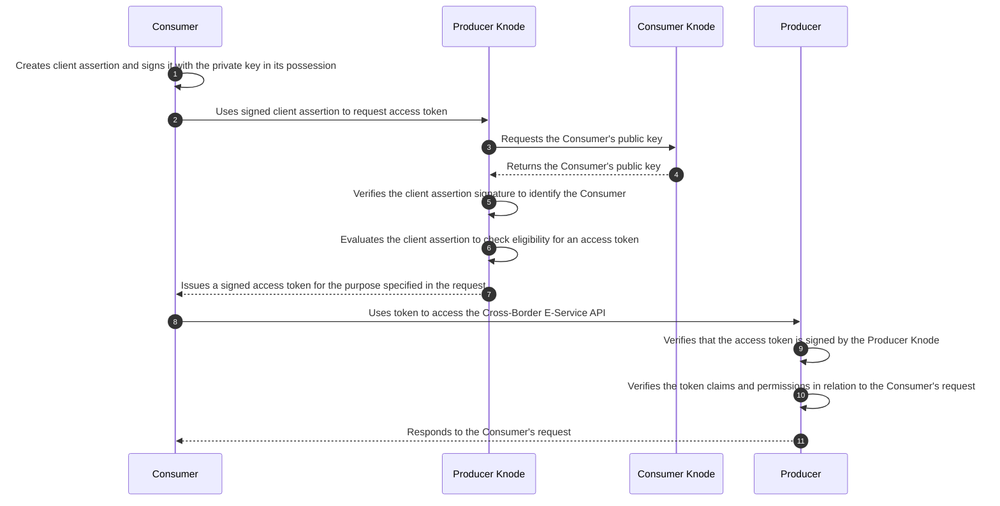

To access a **Cross-Border E-Service**, after completing the access request (**Authorization Request** and **Purpose Statement**) and associating a **Consumption Keychain** with the declared purposes, the **Consumer** can request the issuance of an access token from the **Knode** where the **Producer** is onboarded.

The sequence diagram below shows the steps taken in the standard flow.

The **Signed Client Assertion** created by the **Consumer** and the **Signed Access Token** issued by the **Producer Knode** are JWTs whose claims are determined by the nature of the access token (**Bearer** or **DPoP**) selected for the **Cross-Border E-Service**.

The following table shows the parameters related to the authorization servers of the two **Knodes** implemented in the **Knodia Prototype**.

| Knode | Service Name | URL | Audience |
|---|---|---|---|
| Lynx | ESERVICE AUTH SERVER | `https://auth.lynx.test.knodia.com/token` | `auth.lynx.test.knodia.com/token` |
| Lynx | KNODE_API AUTH SERVER | `https://auth.lynx.test.knodia.com/knodeApiToken` | `auth.lynx.test.knodia.com/knodeApiToken` |
| Orion | ESERVICE AUTH SERVER | `https://auth.orion.test.knodia.com/token` | `auth.orion.test.knodia.com/token` |
| Orion | KNODE_API AUTH SERVER | `https://auth.orion.test.knodia.com/knodeApiToken` | `auth.orion.test.knodia.com/knodeApiToken` |

The API documentation for the Authorization Servers is available at:
- For Lynx: [https://auth.lynx.dev.knodia.com/docs](https://auth.lynx.dev.knodia.com/docs)
- For Orion: [https://auth.orion.dev.knodia.com/docs](https://auth.orion.dev.knodia.com/docs)
