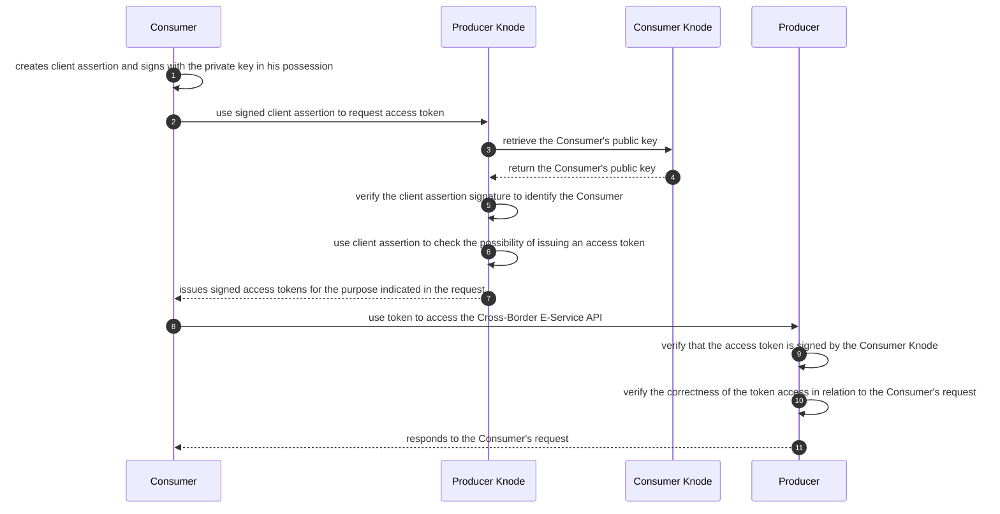

To access an **Cross-Border E-service**, after completing the access request (**Authorization request** and **Purpose Statement**) and associating a **Consumption Keychain** with the declared purposes, the **Consumer** can request the issuing of an access token to the **Knode** where the **Producer** is onboarded.

The sequence diagram below shows the steps taken in the best case.

The **Signed Client Assertion** created by the **Consumer** and the **Signed Access Token** issued by the **Producer Knode** are JWT whose claims are determined by the nature of the access token (**Bearer** or **DPoP**) selected for the **Cross-Border E-service**.