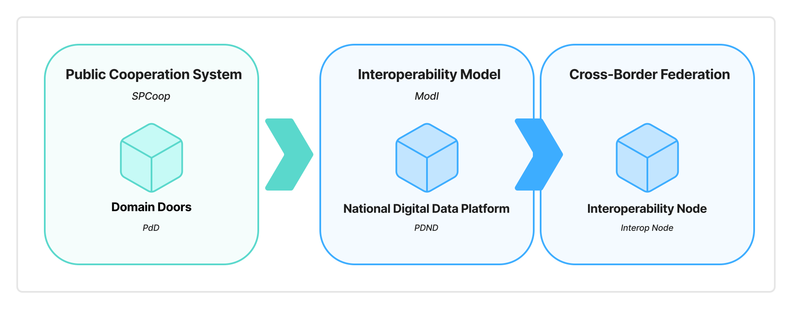

# Abstract

This document describes the Italian proposal to the *Interoperable Europe Board*, established by the *Interoperable Europe Act*, concerning an experimentation – within the *interoperability regulatory sandboxes* of the *Interoperable Europe Act* – of a *Cross-Border Federation* managing authentication and authorization of interested organizations to enable data exchange on digital channels and integration of cross-border digital services.

This *cross-border authentication and authorization framework* is intended as a technical and administrative solution to enable digital interaction between organizations of different Member States, and between these and the agencies of the *European Commission* and the *European Union* in general. The solution implements the API-first approach and is intended to ease the implementation of the once-only principle.

The *Cross-Border Federation* proposal originates from the positive experience of the *Piattaforma Digital Nazionale Dati* in Italy. The latter is the infrastructure for authentication and authorization of organizations – both public and private subjects – within the reference architecture of the *interoperability model* of Italian public administrations.

The *Cross-Border Federation* proposal is intended to comply with the current European regulatory framework on interoperability and on protection of personal data of natural persons.

This document is organized in four distinct chapters. Specifically:

- [**Regulatory context**](./02_regulatory-context.md) considers this proposal in the context of Regulation (EU) 2024/093.
- [**Objective of the proposal**](./03_objective-of-the-proposal.md) presents the objectives which this proposal intends to fulfil.
- [**The Cross-Border Federation as an evolution of the Italian interoperability experience**](./04-00_italian-interop-intro.md) summarizes the Italian experience on interoperability from which this proposal originates.
- [**Cross-border federated interoperability**](./05-00_crossborder-federated-interop.md) describes the proposal in terms of the elements that compose the *Cross-Border Federation* and the methods used by its participants to implement it.
