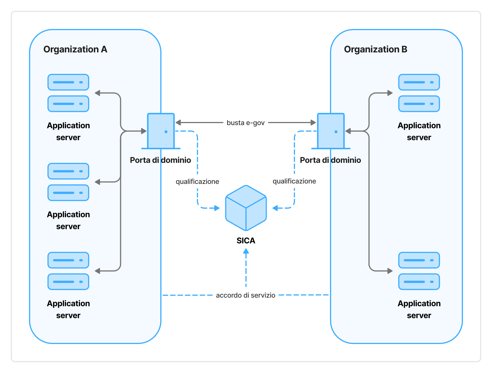

The *SPCoop* constituted the conceptual and architectural model of application cooperation between Italian public entities. It aspired to:

1. Define the method of delivering application services to realize interactions between cooperating entities.
2. Ensure parity among all cooperating entities and the separation of respective responsibilities.
3. Guarantee the independence of cooperating entities in relation to their organizational structures and the management of their IT systems.
4. Delegate to individual cooperating entities the responsibility for authorizing access to data and/or services they provide.

The adoption of the *SPCoop* by Italian public administrations derived from the provisions of the **Decreto del Presidente del Consiglio dei Ministri del 1 aprile 2008 - Regole tecniche e di sicurezza per il funzionamento del Sistema pubblico di connettività previste dall’articolo 71, comma 1-bis del decreto legislativo 7 marzo 2005, n. 82[1[^1]]**. It was fully delineated on the technical-implementation level by guidelines that provided for the use of standards that were well-established at the time of their adoption.

[^1]: https://www.gazzettaufficiale.it/eli/id/2008/06/21/08A04425/sg

The *SPCoop* was based on the following principles:

- **Cooperation between administrations:** Public entities cooperated through the provision and use of application services. Such services were offered by each public entity through a single component of its IT system called the *Porta di Dominio*.
- **Scope of responsibility:** Each cooperating public entity maintained responsibility for the services it provided and the data supplied through such services.
- **Service agreements:** An application service operated on the basis of agreements stipulated between at least two entities (producer and consumer), based on consultation between them, and subsequently formalized by them in *Service Agreements* (*Accordi di Servizio*), a semi-automatic representation based on XML language.
- **Cooperation technologies:** Application services were provided and consumed through remote invocation technologies and standards. This followed international standards (W3C[2[^2]] and OASIS[3[^3]]) at the time of *SPCoop* adoption, specifically:
    - Simple Object Access Protocol (SOAP) as the application protocol for remote service invocation;
    - Web Service Description Language (WSDL) as the language for interface description.;
    - Universal Description, Discovery and Invocation (UDDI) as the architecture and interface of the registry of provided services with access predominantly based on unique identifiers.

  These were completed by defining national standards, such as the extension to SOAP called *busta e-gov*, to meet the objectives of the *SPCoop*.

[^2]: https://www.w3.org/

[^3]: https://www.oasis-open.org/

In summary, the *SPCoop* was based on the Service-Oriented Computing paradigm and organized as a Service-Oriented Architecture, by adopting international technologies and standards, extended and integrated, to make this architecture suitable for the Italian e-Government context.

To mediate and support cooperation between administrations, the *SPCoop* provided for an infrastructural component, called *Servizi di Interoperabilità, Cooperazione ed Accesso* (*SICA*). This offered infrastructural technological services (registry services, security services, etc.). In particular, the Certification Authority necessary to manage a Public Key Infrastructure (PKI) – as the base mechanism used for managing all cryptographic aspects necessary for the security of the *SPCoop* – was instantiated within the *SICA* security services.

The following figure shows the high-level architecture of the *SPCoop*. It emphasizes that Service Agreements were stipulated autonomously by the interested parties, without tools made available in *SPCoop* for this. Their formalization and upload, also the responsibility of the interested parties, was needed to register to the *SICA*.

