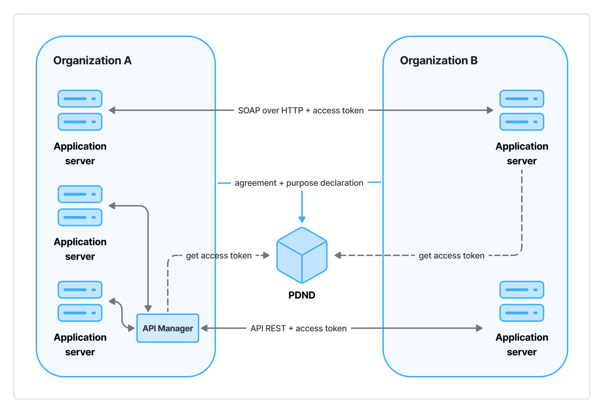

# The Italian interoperability model

The *ModI* considers the digital services (hereinafter *e-services*) created by public entities to ensure access to their data and/or services through the interaction of their IT systems with those of other entities that, in compliance with current legislation, require them to carry out their activities.

The *ModI* critically evolved the *SPCoop* based on the experience gained from the latter's application, to overcome the factors that limited its diffusion.

The adoption of the *ModI* by Italian public administrations is provided for by the **Decreto Legislativo del 7 marzo 2005, n. 82** and, specifically, by:

- Article 73, paragraph 3-ter, letter b), regarding the adoption of guidelines and rules for cooperation and interoperability;
- Article 50-ter, paragraph 2, regarding the *Piattaforma Digitale Nazionale Dati* (briefly *PDND*) as the technological infrastructure that enables the interoperability of IT systems and databases between public entities and between these and private entities.

Operationally, the *ModI* is regulated by guidelines adopted by the *Agenzia per l'Italia Digitale*, in agreement with the *Dipartimento per la trasformazione digitale*, and constantly updated, also by incorporating requests from interested parties.

The *ModI* is based on the following principles:

- **Interactions:** Interactions assume that the involved entities, public and private, can perform the function of *Producer* of *e-services*, when they make digital services available to other entities, and the function of *Consumer* of *e-services*, when they use the *e-services* made available by another entity.
- **Application programming interface:** The *e-services* made available by *Producers* are implemented by application programming interfaces (APIs) using either of these technologies and standards for remote invocation:
    - SOAP and the so-called WS-* stack;
    - REST APIs classifiable at Level 1 of the Richardson Maturity Model, hereinafter HTTP APIs.
- **Interoperability patterns and profiles:** Patterns and profiles of interoperability are progressively identified, with the involvement of interested parties. These define solutions to secure data exchange needs, which *Producers* use to implement their *e-services*.
- **Division of responsibilities:** *Producers* are responsible for the *e-services* they provide, while *Consumers* are responsible for the management of data received through them.
- **Cooperation technologies:** *E-services* are provided and consumed through technologies and standards for remote invocation, standardized (*de iure* and *de facto*) at the international level (W3C[^1], Internet Engineering Task Force[^2], and Linux Foundation[^3]). Specifically:
    - *Regarding SOAP-over-HTTP e-service implementations:*
        - Simple Object Access Protocol (SOAP), as the application protocol for remote service invocation.
        - Web Service Description Language (WSDL), as the language for interface description.
    - *Regarding HTTP-API e-service implementations:*
        - RFC3230, RFC3744, RFC5246, RFC5789, RFC7231, RFC7233, RFC7389, RFC7396, RFC7515, RFC7519, RFC8725, RFC9110, for the implementation of application interfaces (API);
        - OpenAPI Specification, as the language for interface description.
    - *Regarding services offered by the PDND:*
        - RFC6749, RFC6750, RFC7235, RFC7515, RFC7523, RFC9449, for the issuance of authorization tokens;
        - RFC7517, RFC7696, for public key management;
        - RFC3230, RFC3744, RFC5246, RFC5789, RFC7231, RFC7233, RFC7389, RFC7396, RFC7515, RFC7519, RFC8725, RFC9110, for the implementation of application interfaces (API);
        - OpenAPI Specification, as the language for interface description.

[^1]: https://www.w3.org/

[^2]: https://www.ietf.org/

[^3]: https://www.linuxfoundation.org/

The *ModI* preserves the adoption of the Service-Oriented Computing paradigm and the organization as a Service-Oriented Architecture of the *SPCoop*. It includes in its reference architecture the *PDND* as an infrastructural component that provides services to *Producers* and *Consumers* (generally referred to as *Organizations*) to enable interaction between them. In particular:

- It authenticates *Organizations* based on their certain identification at the time of their onboarding to the *PDND* and for their entire period of membership. This is achieved by integration with authoritative sources such as, by way of example, the *Indice dei domicili digitali delle pubbliche amministrazioni e dei gestori di pubblici servizi* (*IPA* – index of digital domiciles of public administrations and private providers of public services) e the *Indice nazionale delle imprese e dei professionisti* (*INI-PEC* – national index of enterprises and profressionals).
- It assigns peculiar characteristics to *Organizations* and maintains them, through the mechanism of certified attributes, based on feedback provided by authoritative sources referring to supervisory or control authorities integrated with the *PDND*.
- It provides an *API Catalogue* that lets *Consumers* verify the availability of *e-services* published by *Producers*, regardless of the possibility of accessing them.
- It provides tools to *Producers* to manage the lifecycle (creation, publication, update, suspension, restoration, deprecation, archiving, and versioning) of their *e-services* published on the *API Catalogue*, including reporting regarding their usage by *Consumers*.
- It allows *Producers*, when publishing their *e-services*, to specify whether *Consumers* must use bearer tokens or tokens including demonstration of proof of possession of cryptographic material (*DPoP* tokens).
- It allows *Producers* to publish *e-services* that permit *Consumers* either to access data held by the *Producer* or to forward data in their possession to the *Producer*.
- It manages agreement requests that allow potential *Consumers* (that possess the certified attributes required by *Producers* at the time of publishing their *e-services*) to signal the intention to use a specific *e-service*. It leaves discretion to the *Producer* to either be only informed of the request or explicitly approve it.
- It manages statements of purpose – a prerequisite to the use of *e-services* – relating to approved agreement requests, to let *Organizations* that receive data record the motivation and regulatory prerequisites justifying the use of the data they obtained via *e-services* (e.g., lawfulness of processing under the *GDPR*).
- It records API clients used by *Consumers* to access *e-services* relative to the declared purposes, and checks of the cryptographic material associated with said clients, primarily needed for preliminary authentication to the *PDND* for the issuance of authorization tokens for access to *e-services*.
- It issues authorization tokens (bearer tokens or *DPoP* tokens) for *Consumers* to access *e-services*. To do so, it verifies the completion of the purpose statement by the *Organization* receiving new data and the status of the associated agreement request.
- It allows inclusion in authorization tokens of the elements needed to apply the asynchronous message exchange model to *e-services* in interactions between *Producers* and *Consumers*.
- It makes *e-service* templates available as a co-design tool to favour the coordination of application domains where several *Organizations* provide analogous *e-services*. It also makes pre-compiled models of purpose statements available to simplify the statement incumbent on *Organizations*.
- It provides tools to allow *Producers* to communicate evidence of changes to data provided by their *e-services* to the *Consumers* of the same who need, consistent with the regulatory framework, to manage these changes.

In short, the *PDND* plays the role of Authorization Server. It applies the Attribute-Based Access Control model regarding the agreement requests initiated by *Consumers* (integrated with purpose statements by *Organizations*) to enable access to *e-services*. It ensures the issuance of authorization tokens to permit interactions between the IT systems of *Producers* and *Consumers*. Furthermore, the *PDND* provides *Organizations* with the services necessary for their full participation to *ModI*, in compliance with current legislation, with particular attention to the protection of personal data, within an administrative and technological security framework for *Organizations*.

The following diagram illustrates the high-level architecture of the *ModI*.

Within the *ModI*, the *PDND*, in addition to performing the function of *Authorization Server*, supports and standardizes the processes of *Organizations*, in particular regarding enabling the use of *e-services*.
