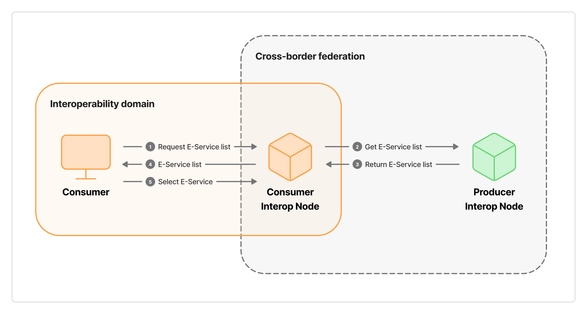
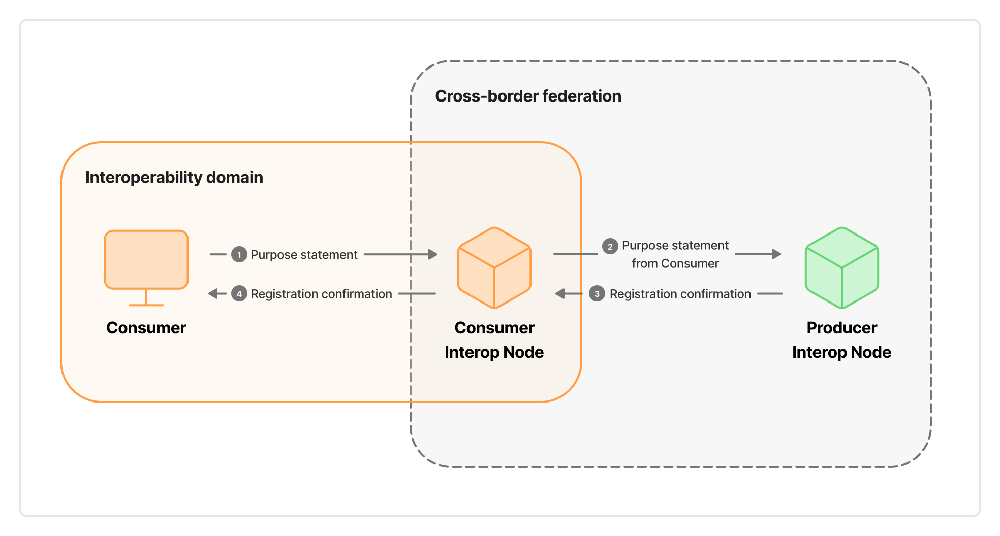
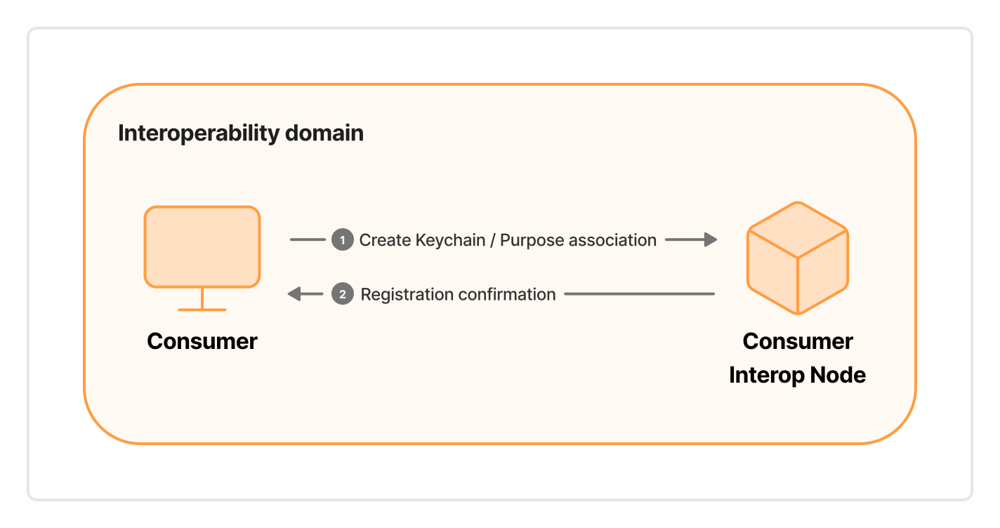
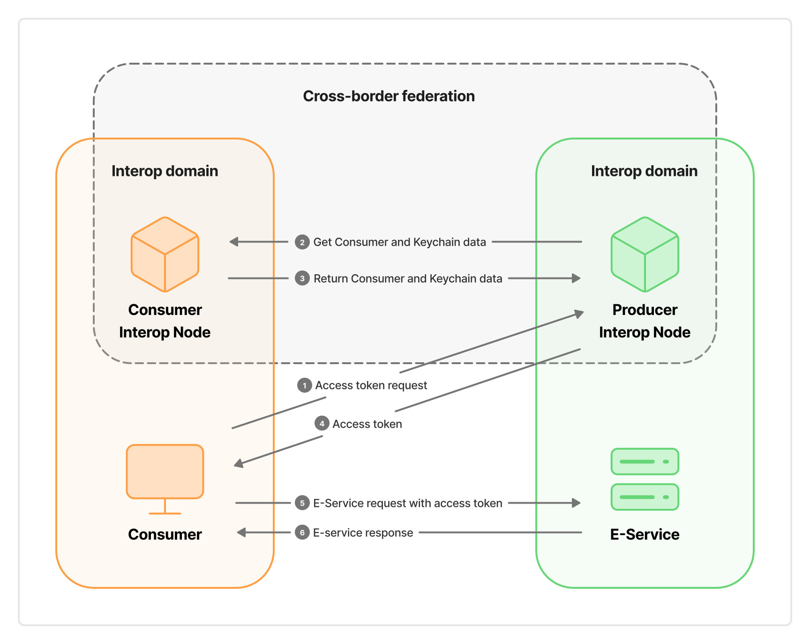

To ease the reading of the subsequent sections, this section describes at a high level the actions that – given a *Cross-Border E-Service* published by a *Producer* on its *Knode* (hereinafter the *Producer Knode*) – allow a *Consumer* belonging to a different *Knode* (hereinafter the *Consumer Knode*) to access the *E-Service*.

# Cross-Border E-Service publication

The *Producer* registers the *Cross-Border E-Service* on the *Producer Knode* to enable cross-border usage. This includes defining the *consumption requirements*, which are the characteristics (*Attributes*) that potential *Consumers* must satisfy to access the *E-Service*.

See § [Cross-Border E-Service publication](./05-04-01_eservice-publication.md) for details.

# Cross-Border E-Service discovery

Potential *Consumers* who need to retrieve data or integrate services beyond their own *Interoperability Domain* can consult the *Cross-Border E-Services* offered by other *Knodes*. This is made possible by the interaction between *Knodes*. The *Consumer* identifies the *Cross-Border E-Service* of interest.

See § [Cross-Border E-Service discovery](./05-04-02_eservice-discovery.md) for details.

# Agreement Request

The potential *Consumer* can initiate an *Agreement Request* for the *Cross-Border E-Service*, provided it possesses the *Attributes* indicated by the *Producer* in the *consumption requirements*. To send the *Agreement Request*, the *Consumer* interacts directly with the *Consumer *Knode**, which forwards the request to the *Producer Knode*.

See § [Agreement Request](./05-05-01_agreement.md) for details.

The *Producer Knode* can request additional information from the *Consumer* to implement the national regulatory framework (see § [Actions requested by the national regulatory framework](./05-05-03_national-regulatory-framework.md)). In this case, the *Consumer* may need to interact directly with the *Producer Knode*.

# Purpose Statement

When the *Agreement Request* is approved, the *Consumer* declares the conditions for the lawfulness of processing (pursuant to Article 6 of the *GDPR*), which allow it to acquire personal data through the *Cross-Border E-Service*. The *Consumer* interacts directly with the *Consumer Knode*, which forwards the statement to the *Producer Knode*.

See § [Purpose Statement](./05-05-02_purpose.md) for details.

The *Producer Knode* can request additional information from the *Consumer* to implement the national regulatory framework regarding the protection of personal data of natural persons (see § [Actions requested by the national regulatory framework](./05-05-03_national-regulatory-framework.md)). In this case, the *Consumer* may need to interact directly with the *Producer Knode*.

# Keychain association

The *Consumer* associates one or more *Keychains* registered on the *Consumer Knode* with the *Purpose Statements* made before. The *Consumer* deposits in the *Keychains* the cryptographic material used by its IT systems (hereinafter *clients*) to access the *Cross-Border E-Service*.

See § [Consumer Keychain association with Purpose Statements](./05-06-03_keychains-purpose.md) for details.

# Access to a Cross-Border E-Service

The information that the *Producer Knode* has received and *Electronically Archived* in the steps described up to now constitutes the technical-administrative prerequisites that enable the *Producer Knode* to issue *access tokens* to the *Consumer*’s *clients* to access the *Producer*’s *E-Service*.

To access a *Cross-Border E-Service*, the following steps must occur:

1. The *Consumer*’s *client* constructs the request to send to the *Producer Knode* to obtain an *access token* related to one of the *Purpose Statements*. It electronically seals the request, using the private cryptographic material corresponding to the public material deposited in the *Keychain*, and sends it to the *Producer Knode*.
2. The *Producer Knode* compares the request content with the information it has *Electronically Archived*. It authenticates the *client*, interacting with the *Consumer Knode* to verify the seal using the public cryptographic material deposited in the Keychain. If verification succeeds, it issues an *access token* to the *Consumer*’s *client*.
3. The *Consumer*’s *client* sends a request to the *Producer*’s *E-Service* using the *access token* issued by the *Producer Knode*.
4. The *Producer*’s *E-Service* verifies the validity and integrity of the received *access token*. If verification succeeds, it prepares and sends the response to the *Consumer*’s *client*.

See § [Issuance of access tokens for Cross-Border E-Services](./05-07-00_tokens.md) for details.

