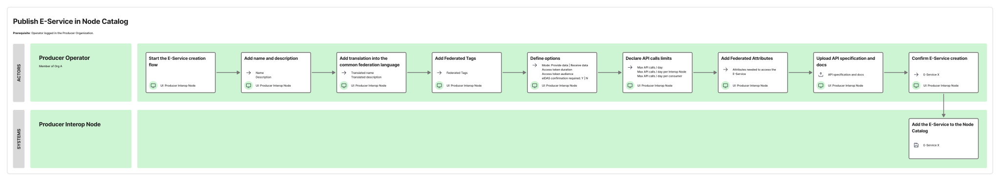

A *Knode* must allow its *Confederate Organizations* that are *Producers* of *Cross-Border E-Services* to publish their *E-Services* on the *Knode Catalogue*.

To publish a *Cross-Border E-Service*, a *Producer* must define its required characteristics as described in § [Cross-Border E-Services](./05-03-00_eservices.md). It must then manage its lifecycle as described in § [Lifecycle of Cross-Border E-Services](./05-09-01_lifecycle-eservice.md).

*Knodia* does not prevent *Interoperability Domains* from defining additional activities for these workflows, provided that any additions do not compromise the usability of the *Cross-Border E-Service* for *cross-border interactions*.

*Knodes* must ensure the following requirements are met:

- *Producers* have the tools needed to publish and manage the lifecycle of the *Cross-Border E-Services* they produce.
- Any additional activity specific to the individual *Interoperability Domain* must not compromise the usability of the *Cross-Border E-Service* for *cross-border interactions*.

The following service blueprint outlines the activities performed by a *Producer* *Operator* on its *Producer *Knode** to publish a *Cross-Border E-Service*. See § [Reading service blueprints](./06-02_reading-service-blueprints.md) for an explanation of the conventions used.

