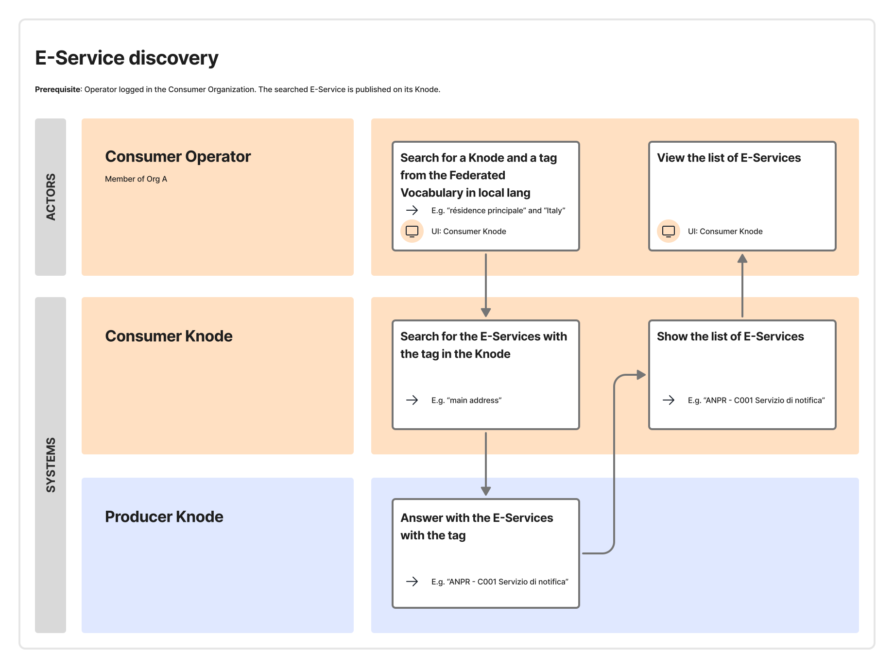

A potential *Consumer* can search for published E-Services through the user interface of their *Consumer Interop Node*. The user interface of every *Interop Node* must allow *Operators* of potential *Consumers* to:

- view the *Cross-Border E-Services* provided by a specific *Producer Interop Node* of interest to the *Consumer*, different from the *Consumer Interop Node*;
- filter the list of E-Services by Federated Category (for example, “main address”, to search for E-Services that provide data on the main address of residence for citizens in the Interoperability Domain represented by the *Producer Interop Node*).

The *Consumer Interop Node* must fetch the Node Catalogue data on demand from the *Producer Interop Node* using the machine-to-machine API defined within the *Cross-Border Federation* and implemented by each *Interop Node* (hereinafter *Federated API*). See § [Distribution of knowledge between Interop Nodes](./05-11-01_distribution-of-knowledge.md) for details.

The following service blueprint defines the flow of activities carried out by the subjects (*Operators* and *Interop Nodes*) to search for a *Cross-Border E-Service*.

For what concerns *Consumers*, *Interop Nodes* must ensure the following requirements are met:

- *Operators* of *Confederate Organizations* can view the *Cross-Border E-Services* of other *Interop Nodes*.
- *Operators* of *Confederate Organizations* can filter the *Cross-Border E-Services* of other *Interop Nodes* by Federated Category.
- The data to display for each E-Service is fetched using the *Federated API* from the corresponding *Interop Node*.

For what concerns *Producers*, *Interop Nodes* must ensure the following requirements are met:

- Published E-Services are made available to other *Interop Nodes* via the *Federated API*.
