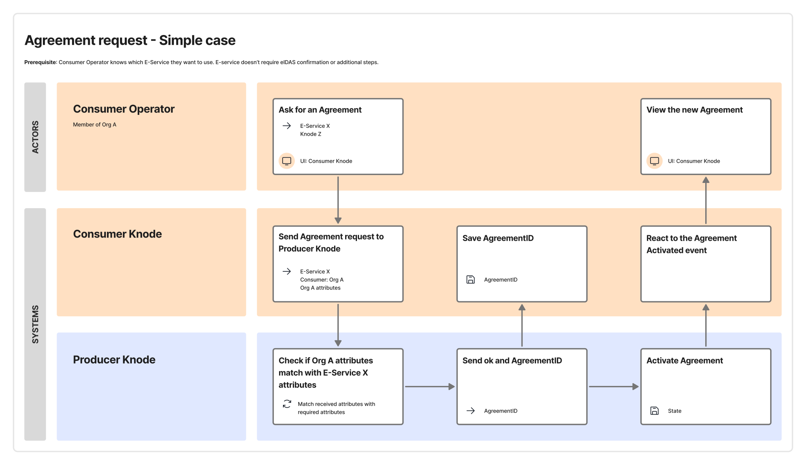
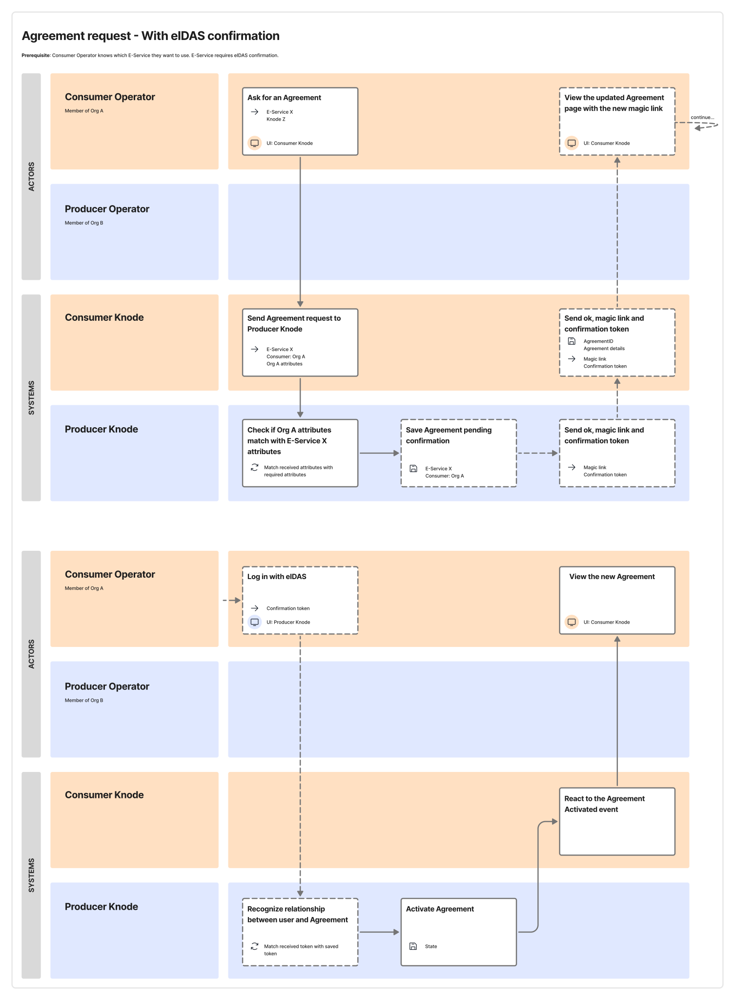

An *Agreement Request* is a digital agreement between *Consumer* and *Producer* related to a *Cross-Border E-Service* produced by the *Producer*. The *Agreement Request* is needed for the *Consumer* to consum the *Cross-Border E-Service*.

For *Provide-Data* E-Services, the *Agreement Request* is not sufficient to allow usage of the *Cross-Border E-Service*, since the *Consumer* must also submit the *Purpose Statement* (see § [Purpose Statement](./05-05-02_purpose.md) for more details).

The *Consumer*, after identifying the *Cross-Border E-Service* it intends to consume, can submit an *Agreement Request* for it via the user interface of the *Consumer Knode*. Using the *Federated API*, the *Consumer Knode* forwards to the *Producer Knode*:

- the identifier to the *Cross-Border E-Service*;
- the identifier to the *Consumer* and its *Federated Attributes*.

The *Producer Knode* can thus verify whether the *Consumer* satisfies the *consumption requirements* of the *Cross-Border E-Service*. If so, it creates and *Agreement Request*, Stores it, and sends its identifier to the *Producer Knode*.

By default, *Knodia* assumes that the *Producer Knode* will activate the *Agreement Request* when it creates it. The following service blueprint illustrates the flow of activities carried out by the subjects in this case.

Activating an *Agreement Request* can require additional actions depending on the regulatory framework that then *Producer Knode* operates in: see § [Actions requested by the national regulatory framework](./05-05-03_national-regulatory-framework.md).

The *Agreement Request* must be filled in at least in the common language accepted by *Knodia*.

The *Consumer Knode* must monitor events concerning state changes of the *Agreement Request* using the *Federated API* and notify them to the corresponding *Consumer*. See § [Distribution of knowledge between Knodes](./05-11-01_distribution-of-knowledge.md) for more details.

The *Consumer Knode* must *Store* the references (identifiers) of:

- the *Agreement Request*, as returned by the *Producer Knode*, so it can later fetch its details using the *Federated API*;
- the *Cross-Border E-Service* involved in the *Agreement Request*;
- the *Producer Knode*.

The *Consumer Knode* must *Electronically Archive* the information on:

- the *Consumer*, including its *Federated Attributes*.

The *Producer Knode* must *Electronically Archive* the information on:

- the *Agreement Request*;
- the *Cross-Border E-Service* involved in the *Agreement Request*;

The *Producer Knode* must *Store* the references (identifiers) of:

- the *Consumer*;
- the *Consumer Knode*.

Each *Producer Knode* must update the state of each *Agreement Request* it has created in response to:

- changes to the *Cross-Border E-Service* originated by the Producer;
- changes to the *Federated Attributes* of the *Consumer*, obtained by monitoring events using the *Federated API* of the *Consumer Knode* (see § [Distribution of knowledge between Knodes](./05-11-01_distribution-of-knowledge.md) for more details).

Specifically, the *Agreement Request* must be suspended if the *Consumer*’s *Federated Attributes* no longer satisfy the *consumption requirements* of the *Cross-Border E-Service*.

Within *Knodia*, for each E-Service and *Consumer*, there can be at most one *Agreement Request*.

See § [Lifecycle of Agreement Requests](./05-09-02_lifecycle-agreement.md) for more details on the lifecycle of *Agreement Requests*.

For what concerns *Consumers*, *Knodes* must ensure the following requirements are met:

- *Confederate Organizations* can submit *Agreement Requests* for *E-Services* and receive notifications concerning these *Agreement Requests*.
- The *Knode* uses the *Federated API* of the *Producer Knode* to forward the request to create an *Agreement Request*.
- The Knode uses the *Federated API* to receive from the *Producer Knode* evidence on the state of the created *Agreement Requests*.
- Changes in the *Federated Attributes* of *Confederate Organizations* are made available to *Producer Knodes* via the *Federated API*.

For what concerns *Producers*, *Knodes* must ensure the following requirements are met:

- *Consumer Knode* can submit the request to create an *Agreement Request* using the *Federated API*.
- The state of the *Agreement Request* is kept up to date.
- Changes in the state of *Agreement Requests* are made available to the *Consumer Knodes* that created them via the *Federated API*.

# Confirmation by the *Consumer* *Operator*

The *Producer* can optionally configure the *Cross-Border E-Service* to request an *Operator* of the *Consumer* to confirm the submission of an *Agreement Request* on the *Producer Knode*.

This allows the *Producer Knode* to *Electronically Archive*, for an *Agreement Request*, the explicit confirmation of an *Operator* of the Consuemr, together with the request received from the *Consumer Knode*.

In this case, when the *Producer Knode* creates the *Agreement Request*, it must send to the *Consumer Knode* (together with the identifier of the *Agreement Request*):

- a link to its user interface that a *Consumer* *Operator* must use to confirm the operation on the *Producer Knode*;
- an (unforgeable) secret token the the aforementioned *Operator* must provide to the *Producer Knode*.

Specifically, to confirm submission of an *Agreement Request*, an *Operator* of the *Consumer* will have to follow the link, authenticate to the user interface of the *Producer Knode* via *eIDAS login*, and provide the secret token.

The *Consumer Knode* is responsible to provide the link and secret token only the *Operators* of the *Consumer* which are authorized in its domain to carry out this confirmation.

After confirmation, if no other action is needed, the *Producer Knode* activates the *Agreement Request*. This case is illustrated in the following service blueprint.

If the regulatory framework applicalbe to the *Producer Knode* requires additional actions, the *Producer Knode* sets the state of the *Agreement Request* to reflect this (see § [Actions requested by the national regulatory framework](./05-05-03_national-regulatory-framework.md)).

For what concerns Producers, Knodes must ensure the following requirements are met:

- *Producers* can request explicit confirmation from potential *Consumers* before activating their *Agreement Requests*.
- If a *Producer* requests explicit confirmation, the *Producer Knode* returns to interested *Consumer Knodes*, via the *Federated API*, the information needed for *Operators* to fulfil this.

For what concerns *Consumers*, Knodes must ensure the following requirements are met:

- The *Consumer Knode* must monitor state changes of the *Agreement Request* using the *Federated API* to detect when the confirmation has occurred.
- The *Consumer Knode* must forward to interested consumers the information needed to fulfil the *Producer*’s request for explicit confirmation, received from the *Producer Knode*.
