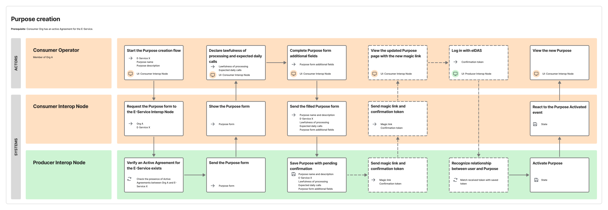
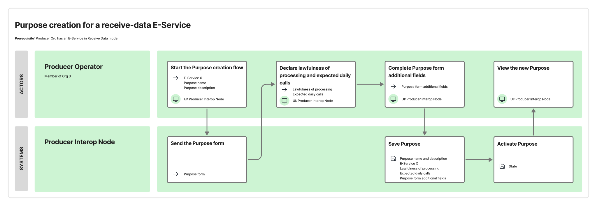

A *Purpose Statement* is the declaration a *Confederate Organization* makes to assert the lawfulness of processing of personal data received through a *Cross-Border E-Service*, pursuant to Article 6 of the *GDPR*.

A *Purpose Statement* is necessary to enable the *Consumer* to access a *Cross-Border E-Service*, even if the *Producer* has declared that the *Cross-Border E-Service* does not provide or process personal data of natural persons.

This declaration is made:

- for *Provide-Data* *Cross-Border E-Services*, by the *Consumers*, for each *E-Service* they have an active *Agreement Request* for, and each data processing purpose they will apply on the *E-Service* data;
- for *Receive-Data* *Cross-Border E-Services*, by the *Producer* when publishing the *E-Service*.

Within *Knodia*, *Purpose Statements* are characterized by:

- an identifier which is unique within the *Interoperability Domain*;
- name and description;
- indication of the lawfulness of processing, as a value chosen from the options admitted by Article 6 of Regulation (EU) 2016/679;
- any additional information required by the national regulatory framework to which the *Producer Knode* is subject regarding the protection of personal data of natural persons (see § [Actions requested by the national regulatory framework](./05-05-03_national-regulatory-framework.md)).

The *Purpose Statements* must be filled in at least in the common language accepted by *Knodia*.

The *Consumer* must declare the load it expects to place on the *Cross-Border E-Service*, expressed as a maximum number of requests per unit of time. This parameter is useful to the *Producer* to evaluate the dimensioning of its technological infrastructure. Specifically:

- for *Provide-Data* *E-Services*, the *Consumer* declares it in each *Purpose Statement* it creates;
- for *Receive-Data* *E-Services*, the *Consumer* declares it by selecting the *Purpose Statement* created by the *Producer*.

Each *Producer Knode* may choose to define and perform checks comparing the load declared by the *Consumer* to the quotas defined by the *Producer* of the *Cross-Border E-Service*. For example, a *Knode* may choose:

- not to perform any check (the load declaration is only used to inform the *Producer*, who can dimension infrastructure accordingly and possibly defer or reject requests in excess of the declared load);
- to prevent the creation of new *Purpose Statements* if existing *Purpose Statements* saturate the quotas declared by the *Producer* for that *E-Service*.

See § [Lifecycle of Purpose Statements](./05-09-03_lifecycle-purpose.md) for more details on the lifecycle of *Purpose Statements*.

***Consumer Knodes* must ensure the following requirements are met:**

- ***Confederate Organizations* can create or select (respectively, for *Provide-Data* or *Receive-Data* *Cross-Border E-Services*) the *Purpose Statements* for *Cross-Border E-Services* and receive notifications related to them.**
- **The *Consumer Knode* must forward the request to create a *Purpose Statement* to the *Producer Knode* using the *Knodia API*.**
- **The *Consumer Knode* must receive from the *Producer Knode*, using the *Knodia API*, evidence on the state of *Purpose Statements* it has created.**

***Producer Knodes* must ensure the following requirements are met:**

- **The *Producer Knode* must allow other *Knodes* to create *Purpose Statements* (for *Provide-Data* *Cross-Border E-Services*) or to retrieve existing *Purpose Statements* created by the *Producer* (for *Receive-Data* *Cross-Border E-Services*) using the *Knodia API*.**
- **Changes in the state of *Purpose Statements* are made available to the *Consumer Knodes* that created them via the *Knodia API*.**

# Purpose Statements for Provide-Data E-Services

A *Consumer* *Operator* may, through the user interface of the *Consumer Knode*, make one or more *Purpose Statements* related to a *Cross-Border E-Service* for which it has an active *Agreement Request*.

The *Consumer Knode*:

1. requests to the *Consumer* *Operator* to fill in the required information according to the requirements defined in the § [Purpose Statement](./05-05-02_purpose.md) above;
2. retrieves from the *Producer Knode*, using the *Knodia API*, the form for any additional information requested by the national regulatory framework (see § [Actions requested by the national regulatory framework](./05-05-03_national-regulatory-framework.md) for details);
3. provides the form to the *Consumer* *Operator* to fill in;
4. forwards the filled-in data to the *Producer Knode* using the *Knodia API*.

The *Producer Knode* creates the *Purpose Statement* and returns its reference to the *Consumer Knode*.

The *Consumer Knodes* must *Store* the references:

- of the *Purpose Statement*, as returned by the *Producer Knode*, to be able to retrieve its data later using the *Knodia API*;
- of the *Cross-Border E-Service* subject of the declaration;
- of the *Producer Knode*.

The *Consumer Knode* must *Electronically Archive* the information:

- on the *Consumer*, including its *Knodia Attributes*.

The *Producer Knode* must *Electronically Archive* the information:

- of the *Purpose Declaration*;
- of the *Cross-Border E-Service* subject of the declaration.

The *Producer Knode* must *Store* the references:

- of the *Consumer*;
- of the *Consumer Knode*.

The default behaviour in *Knodia* is for the *Producer Knode* to activate the *Purpose Declaration* simultaneously when it is created.

The *Purpose Statement* may instead need further confirmation by a *Consumer* *Operator* if the *Producer* requested it when creating the *Cross-Border E-Service*. In this case, the procedure is equivalent to that described for confirmation of *Agreement Requests* (see § [Agreement Request – Confirmation by the Consumer Operator](./05-05-01_agreement.md#confirmation-by-the-consumer-operator)).

The following service blueprint outlines the activities performed by the subjects (*Operators* and *Knodes*) in the latter case.

In any case, the *Consumer Knode* must monitor state change events for the *Purpose Statement* using the *Knodia API* and notify the corresponding *Consumer*. See § [Distribution of knowledge between Knodes](./05-11-01_distribution-of-knowledge.md) for more details.

***Producer Knodes* must ensure the following requirements are met:**

- ***Producers* can request explicit confirmation from potential *Consumers* before activating their *Agreement Requests*.**
- **If a *Producer* requests explicit confirmation, the *Producer Knode* returns to interested *Consumer Knodes*, via the *Knodia API*, the information needed for *Operators* to fulfil this.**
- **If any additional information is requested from the *Consumer* in relation to the regulation for protection of personal data of natural persons, the *Producer Knode* must provide interested *Consumer Knodes*, through the *Knodia API*, with the form to collect this information and the operations to receive it after it is completed.**

***Consumer Knodes* must ensure the following requirements are met:**

- ***Consumer Knodes* must monitor, using the *Knodia API* of the *Producer Knodes*, state changes of *Purpose Statements*, to react when the confirmation is given.**
- **If any additional information is requested from the *Consumer* in relation to the regulation for protection of personal data of natural persons, the *Consumer Knode* must retrieve the form to collect this information and forward it to the *Producer Knode*.**

# Purpose Statements for Receive-Data E-Services

A *Cross-Border E-Service* in the *Receive-Data* mode allows its *Producer* to collect data from *Consumers*. In this case, the *Purpose Statement* must be issued by the *Producer*, the subject that processes the data.

The *Producer Knode* must provide functionality for *Producers* to enter the required information in accordance with the requirements defined in the § [Purpose Statement](./05-05-02_purpose.md) above.

The *Consumer Knode*, when a *Consumer* has an active *Agreement Request* for a *Receive-Data* *Cross-Border E-Service*, must retrieve from the *Producer Knode*, using the *Knodia API*, the *Purpose Statements* and make them available to the *Consumer*.

The following service blueprint illustrates the flow of activities for purpose creation in the *Receive-Data* case:

***Consumer Knodes* must ensure the following requirement is met:**

- **They must retrieve the *Purpose Statement* issued by the *Producer*, using the *Knodia API*, and make it available to the *Consumer* on their user interface.**

***Producer Knodes* must ensure the following requirement is met:**

- **They must make the *Purpose Statement* issued by the *Producer* available through the *Knodia API* to *Consumer Knodes*.**
