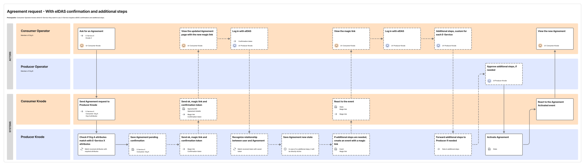

# Additional actions for Agreement Requests

As mentioned in § [Agreement Request](./05-05-01_agreement.md), additional actions may be needed to activate an *Agreement Request*. This is at the discretion of the *Producer Knode*. It makes it possible for *Knodes* to implement any additional steps demanded by the national regulatory framework they are subject to: for example, request additional information from the *Consumer* to complete the proceedings.

For this reason, after the request is submitted by the *Consumer*, the *Consumer Knode* must monitor state change events for the *Agreement Request* using the *Federated API*. See § [Distribution of knowledge between Knodes](./05-11-01_distribution-of-knowledge.md) for more details.

Before the *Agreement Request* reaches the active state, it can transit through one or more of these states:

- additional action requested to a *Producer* *Operator*, e.g., manual approval;
- additional action requested to a *Consumer* *Operator*.

The first case is managed internally to the *Producer Knode*.

In the second case, the *Producer Knode* must include, in the state change event, a link and any additional elements needed for the *Customer* to be able to carry out the requested actions.

When the *Producer Knode* forwards such a link, it must ensure that its user interface supports at least the common language accepted by *Knodia*.

When the *Consumer Knode* receives the link and any additional elements, it must provide them to *Consumer* *Operators* to let them carry out the requested actions.

The following service blueprint outlines the activities performed by the subjects, *Operators* and *Knodes*, in this case.

***Producer Knodes* must ensure the following requirement is met:**

- **If additional actions are needed by the *Consumer*, it must notify them to the interested *Consumer Knode* using the *Federated API*, including the link and any additional elements needed to carry out the requested actions.**

***Consumer Knodes* must ensure the following requirements are met:**

- **They must retrieve from the *Producer Knode*, using the *Federated API*, the link and any additional elements needed to carry out the requested actions.**
- **They must forward the link and any additional elements received from the *Producer Knode* to the *Consumer*.**

# Additional information for Purpose Statements

As mentioned in § [Purpose Statement](./05-05-02_purpose.md), additional information beyond the default can be needed for the *Purpose Statement*. This is at the discretion of the *Producer Knode*, to comply with the national regulatory framework they are subject to.

This request for additional information occurs using a custom form defined by the *Producer Knode*. See § [Purpose Statement](./05-05-02_purpose.md) for the service blueprint and the description of how this form is transmitted between *Knodes* when the statement must be made by the *Consumer*.

This form:

- must be defined following a format shared within *Knodia* which supports multiple languages;
- must be made available by the *Producer Knode* at least in the common language accepted by *Knodia*;
- must accept responses in any of the languages it is made available in.

Defining the standard format which every *Knode* must use to define this form is a responsibility of the *Knodia Consortium* mentioned in § [Configuration of the federation of Knodes](./05-11-02_federation-configuration.md).

***Producer Knodes* must ensure the following requirements are met:**

- **They must use the standard format of *Knodia* to define the form which *Customers* of *Cross-Border E-Services* must fill in.**
- **They must provide the form to *Consumer Knodes* using the *Federated API*.**

***Consumer Knodes* must ensure the following requirements are met:**

- **They must retrieve the form from the *Producer Knode* using the *Federated API*.**
- **They must let *Consumer* *Operators* view and fill in the form.**
