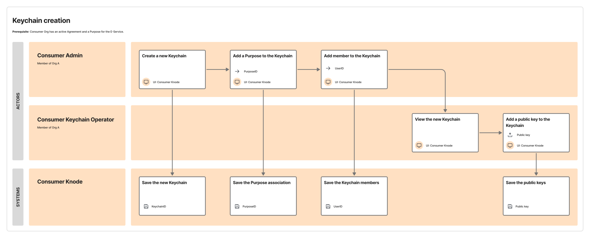

# Consumer Keychain association with Purpose Statements

A *Consumer Keychain* can be used to consume multiple E-Services. To this end, the *Consumer Keychain* is associated with a set of active *Purpose Statements*.

The user interface of the *Consumer Interop Node* must allow Consumer *Operators* to associate the Consuemr Keychain to one or more active *Purpose Statements*. For *Receive-Data* E-Services, the *Purpose Statement* associated to the *Consumer Keychain* is one that the *Producer* has created when publishing the *Cross-Border E-Service* itself.

The association occurs via the identifiers of the *Purpose Statements* stored when they are created.

The *Consumer Keychain* can afterwards be used to request *access tokens* for the related E-Services.

***Consumer Interop Nodes* must ensure the following requirements are met:**

- **They must let *Consumers* associate *Keychains* to *Purpose Statements*.**

The following service blueprint illustrates the flow in an example case in which the *Consumer Interop Node* has defined two distinct roles for its *Operators*. See § [Management of Operators](./05-02-02_management-of-operators.md) for more details. This example considers two roles:

- Admin, who can create *Consumer* Keychains and associate them with *Operators* with the Keychain *Operator* role;
- Keychain *Operator*, who can deposit public cryptographic material.

