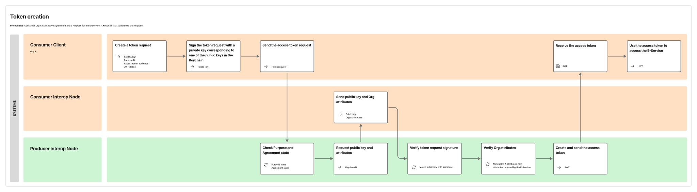

The *Consumer* requests an *access token* for a *Cross-Border E-Services* by making a request to the token endpoint of the *Producer Knode* with an attached client assertion as defined in § [Consumer Keychains – Context of use](./05-06-01_keychains-context.md). The assertion must contain at least the following attributes:

- sub and iss: identifiers of the *Consumer* Keychain containing the public cryptographic material corresponding to the seal applied to the client assertion;
- aud: the audience defined when the *Cross-Border E-Services* was created;
- purposeId: the identifier of a *Purpose Statement* associated with the *Cross-Border E-Service* and the *Consumer Keychain*;
- jti: a random unique identifier assigned by the *Consumer*;
- iat: the timestamp reporting the date and time the token is created;
- exp: the timestamp reporting the date and time of token expiration.

The *Producer Knode* follows these steps to issue the token:

1. Retrieve the needed information using the *Federated API* of the *Consumer Knode*:
  - data of the *Consumer Keychain*: public cryptographic material and associated *Purpose Statements*;
  - data of the *Consumer* and its *Federated Attributes*.
2. Authenticate the *Consumer*, that is, verify the seal of the client assertion against the public cryptographic material in the keychain.
3. Authorize, that is, verify:
  - that the *Purpose Statement* referred to in the client assertion is active and associated to the Keychain;
  - that there exists an active *Agreement Request* for the *Consumer* for that *E-Service*;
  - that the *Cross-Border E-Service* is in a state in which it can be consumed (see § [Lifecycle of Cross-Border E-Services](./05-09-01_lifecycle-eservice.md));
  - that the *Consumer*’s *Federated Attributes* satisfy the *consumption requirements* of the *Cross-Border E-Service*.

If the verification succeeds, the *Producer Knode* creates and seals the *access token* and returns it to the *Consumer*. The *Consumer* can then call the *Cross-Border E-Service* using the token as HTTP Authentication in Bearer mode.

The *Producer* is responsible to implement verification of the *access token* in the *Cross-Border E-Service*. That is must check that it is a valid JWT, as concerns expiration and audience, and that it is electronically sealed by the *Producer Knode* (which guarantees authenticity and integrity). To allow this, the *Producer Knode* must make its own public cryptographic material, with which it seals the *access tokens* it issues, publicly available as a well-known JSON web keyset (JWKS).

The implementation details of the token endpoint, which the *Producer Knodes* must implement, shall be part of the specification of *Knodia* produced by the Federated Consortium, as described in § [Considerations on the governance of Knodia](./05-11-00_federation-governance.md).

***Consumers* must ensure the following requirements are met:**

- **They must request an *access token* to be issued to the *Producer Knode* corresponding to the *Cross-Border E-Service* of interest and in relation to a specific active *Purpose Statement*.**
- **They must use the *access token* issued by the *Producer Knode* to request access to the *Producer* for the *Cross-Border E-Service* of interest.**

***Producer Knodes* must ensure the following requirements are met:**

- **They must implement the token endpoint that issues *access tokens*, following the specifications of *Knodia*, and make it available to *Consumers*.**

***Producers* must ensure the following requirements are met:**

- **They must validate the *access token* sent by the *Consumer* before granting access to their *Cross-Border E-Service*.**

