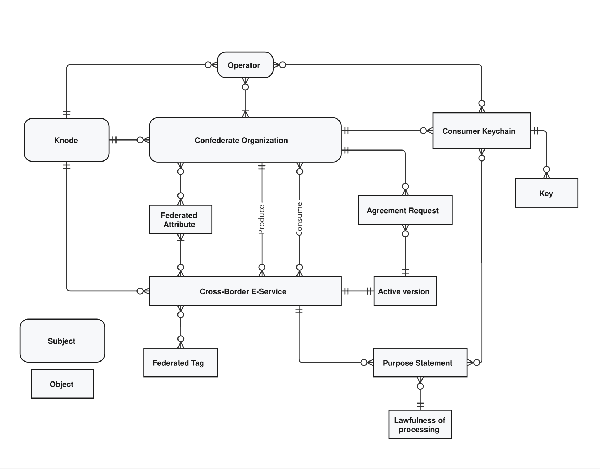

# Lifecycle of entities

This section describes the lifecycle of the *Cross-Border E-Service*, *Agreement Request*, and *Purpose Statement* entities.

To help the reader to consider these entities in their context, the following diagram illustrates them, and others cited heretofore, with their relationships expressed in crow's foot notation.

