A *Cross-Border E-Service* can have one or more versions. *E-Service* versioning allows the *Producer* to update the description of the provided functionality (for example, by uploading an updated OpenAPI specification).

This concept was not mentioned up to now, to keep a simpler presentation.

The first version of the *Cross-Border E-Service* is created by the *Producer* at the same time as the *Cross-Border E-Service* itself. Afterwards, the *Producer* can create and publish an updated version. This automatically deprecates the existing version.

Creating a new version does not prevent *Consumers* to continue consuming the previous, now deprecated, versions. However, *Consumers* must be notified that a new version has been published and the one they are consuming is deprecated. The notification should prompt *Consumers* to upgrade to consume the new version. *Agreement Requests* are themselves associated to specific versions, not generically to the *Cross-Border E-Service*.

The following diagram represents the states and lifecycle of each *E-Service* version. State transitions in the diagram are labelled with an icon to identify the actors that can perform that action.

Relevant states for *Cross-Border E-Service* versions are:

- **Active:** The *Cross-Border E-Service* version has been published in the catalogue and can be used.
- **Suspended:** The *Producer* has temporarily suspended operation of the *Cross-Border E-Service* – e.g., due to technical or administrative problems – but can reactivate it later. This suspends issuance of *access tokens*.
- **Deprecated:** The *Producer* has marked the version as deprecated or has created a new version for the *Cross-Border E-Service*, noting that this version will be disabled in the future. New *Agreement Requests* for that version are not accepted. A deprecated version can still be used, therefore it too can be temporarily suspended if needed.
- **Archived:** The version is no longer operating and will not be reactivated. The *Producer* can manually archive a deprecated version (respecting advance notification to *Consumers* and other conditions the *Knode* can impose). Archiving also occurs automatically when the deprecated version is not consumed any more by any Consumer.

