The following diagram illustrates the lifecycle of an *Agreement Request*, starting when the Customer requests its creation through its *Consumer Interop Node*. The diagram uses choice nodes to indicate that confirmation via eIDAS login is optional.

The states are:

- **Pending Operator confirmation:** The *Agreement Request* is created by the *Producer Interop Node* in this state if the *Producer* requested, for that E-Service, that a *Consumer* *Operator* confirms the operation via eIDAS login on the *Producer Interop Node*.
- **Submitted:** The *Agreement Request* has been created but is not active yet. Depending on the policy of the *Producer Interop Node*, it could be activated or rejected automatically or it could require manual approval. The *Consumer* could also be asked (automatically or after a manual action by the *Producer*) to complete further steps. The *Agreement Request* leaves this state if it is activated (by the *Producer* or automatically by the *Producer Interop Node*) or archived (because it is rejected by the *Producer*, automatically rejected by the *Producer Interop Node*, or deleted by the *Consumer*).
- **Active:** The *Agreement Request* has been approved and is active. The *Consumer* can request *access tokens* to be issued for the corresponding E-Service.
- **Suspended:** The *Agreement Request* has been temporarily suspended, e.g., due to technical or administrative problems. The *Consumer* cannot request *access tokens* for the corresponding E-Service. The *Agreement Request* can be suspended by the *Producer*, by the *Consumer*, or automatically by the *Producer Interop Node* (for example, if the *Consumer* no longer has one of the *Federated Attributes* in the consumption requirements). Multiple actors can suspend the *Agreement Request* contemporaneously. The *Agreement Request* is then reactivated only if all actors that had suspended it reactivate it.
- **Archived:** The *Agreement Request* has been archived and is no longer valid. The *Consumer* can archive an *Agreement Request* manually. An *Agreement Request* is also archived if it is rejected or conditions intervene which prejudice its existence.

