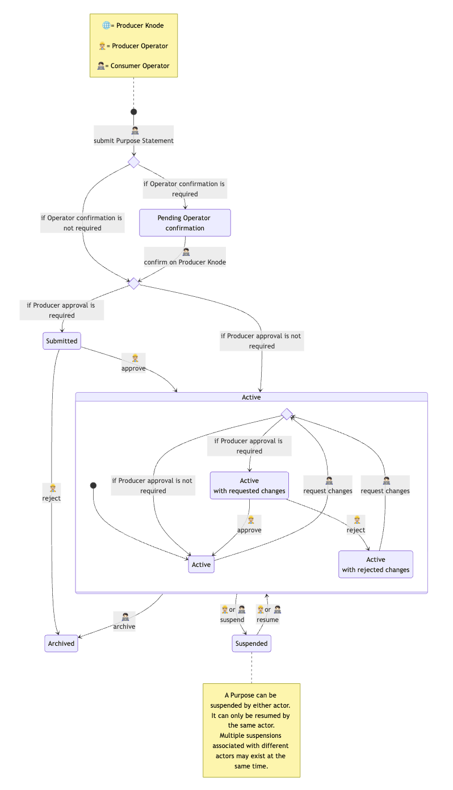
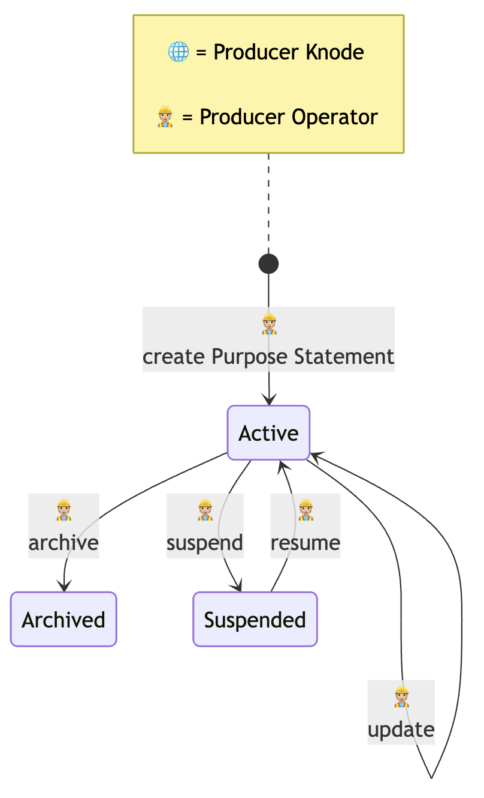

The following diagram illustrates the lifecycle of a *Purpose Statement* created by a *Consumer* to access a *Provide-Data* *Cross-Border E-Service*. In the diagram, choice nodes represent optional steps, and a composite state represents the possible sub-states for an active *Purpose Statement*.

The states are:

- **Pending Operator confirmation:** The *Purpose Statement* is created by the *Producer Knode* in this state if the *Producer* requested confirmation from a *Consumer* *Operator* via *eIDAS login* on the *Producer Knode* for that *Cross-Border E-Service*
- **Submitted:** The *Purpose Statement* has been created, but the *Producer* must approve it. The *Producer* can approve it or reject it. *Producer* approval may not be necessary, depending on the policies of the *Producer Knode*.
- **Active:** The *Purpose Statement* has been approved and is active. The *Consumer* can request *access tokens* for the corresponding *E-Service*. This state includes two distinct sub-states:
  - **Active, with requested changes:** The *Consumer* has requested to update the *Purpose Statement*. The *Purpose Statement* remains in its current state until the changes are applied, in accordance with the policies of the *Producer Knode*.
    - Note: This state is necessary to let the *Consumer* update an active *Purpose Statement*, for example, to change the expected load (maximum number of requests per unit of time), without losing access to the *Cross-Border E-Service* while the approval is pending. The *Consumer* could, alternatively, create a new *Purpose Statement*, with the new load, and keep the previous one active until the new one is activated, and then archive it. However, if the *Producer Knode* limits the creation of new *Purpose Statements* based on the *Cross-Border E-Services* quotas, this might not be possible: the *Consumer* might not be able to create a new *Purpose Statement* until it has archived the existing one. Modelling the change request explicitly avoids this issue.
  - **Active, with rejected changes:** The changes requested by the *Consumer* have been rejected. The *Purpose Statement* remains unchanged. The *Consumer* may request new changes.
- **Suspended:** The *Purpose Statement* has been temporarily suspended, e.g., due to technical or administrative problems. The *Consumer* cannot request *access tokens* for the corresponding *E-Service*. The *Purpose Statement* can be suspended by the *Producer*, by the *Consumer*, or by both. It is again active only if all actors who had suspended it reactivate it.
- **Archived:** The *Purpose Statement* has been archived and is no longer valid. The *Consumer* can manually archive a *Purpose Statement*. A *Purpose Statement* is also archived if the *Producer* refuses to activate it.

The following diagram illustrates the lifecycle of a *Purpose Statement* created by a *Producer* for one of its *Receive-Data* *E-Services*.

The states are:

- **Active:** The *Purpose Statement* has been created and is active. In this state, the *Producer* can also update the *Purpose Statement*.
- **Suspended:** The *Purpose Statement* was temporarily suspended, e.g., due to technical or administrative problems. *Consumers* cannot request *access tokens* for the corresponding *E-Service*.
- **Archived:** The *Purpose Statement* has been archived and is no longer valid.

