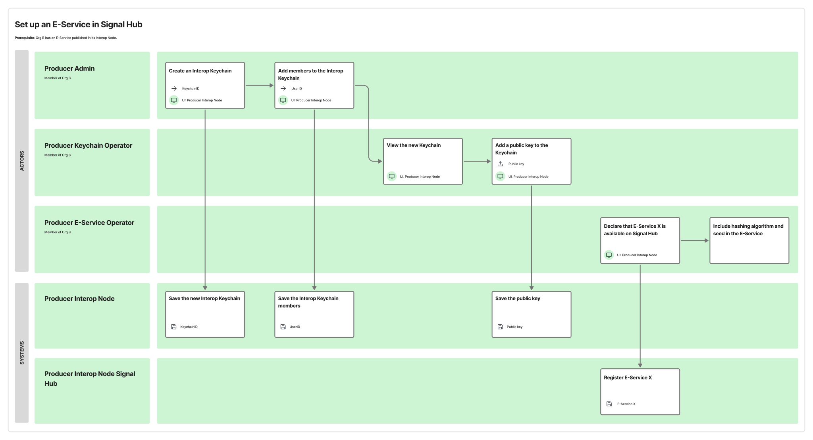
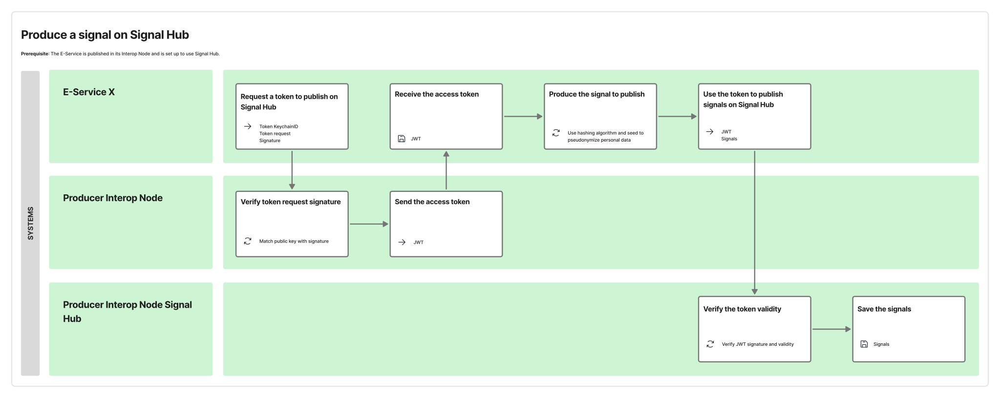
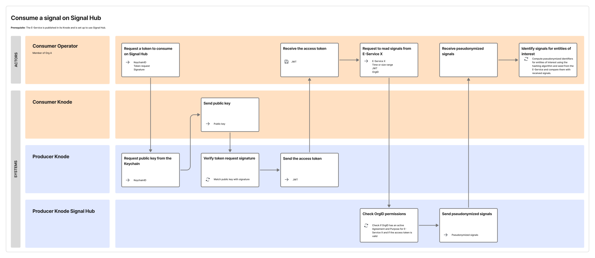

Beyond the usual model of consumption (i.e., a *Consumer* calls the *Cross-Border E-Services* offered by *Producers*), the *Interop Node* may also provide a signal distribution system that lets *Consumers* detect when change occur in the data provided by a *Cross-Border E-Service* (which the *Consumer* is authorized to consume) referring to entities the *Consumer* is interested in.

This functionality is intended to allow *Consumers* to react promptly to update information on subjects for whom the *Consumer* has outstanding processing operations, while avoiding excessive load on *Producers* (which would be imposed by *Consumers* repeatedly fetching the data to monitor it for changes). Moreover, this standardizes throughout the *Cross-Border Federation* a single model to distribute data changes.

To support this, the *Interop Node* must implement a service – here referred to as the Signal Hub. The Signal Hub allows *Producers* of that *Interop Node* to deposit signals related to data changes for a *Cross-Border E-Service*, after enabling the Signal Hub for that service. It allows any *Consumer* (throughout the *Cross-Border Federation*) to retrieve the signals it is interested in. To retrieve signals, the *Consumer* needs an active *Agreement Request* and at least one active *Purpose Statement* for the *Cross-Border E-Service*.

The *Federation Consortium* referred to in § [Considerations on the governance of the Cross-Border Federation](./05-11-00_federation-governance.md), capitalizing on the effects of the proposed experimentation, defines in detail how to implement this functionality.

The remainder of this section reports considerations on this functionality based on the experience with the PDND in Italy.

# Signals and pseudonymization

A signal is an object that serves as a notification of data change. It identifies the entity whose data changed. Entities are identified pseudonymously, using a hashing algorithm. This allows the *Consumer* to reconcile them by comparing the entity identifiers the *Consumer* already know with their pseudonymous representation included in the signals.

To make pseudonymization more secure, hashing with a seed[1[^1]] is used. The *Producer* must expose in its *E-Service* the reference to the hashing algorithm and the seed it currently uses.

[^1]: The Italian implementation of the Signal Hub for the PDND has followed the report “Pseudonymisation techniques and best practices” of the ENISA, available at the URL [https://www.enisa.europa.eu/publications/pseudonymisation-techniques-and-best-practices](https://www.enisa.europa.eu/publications/pseudonymisation-techniques-and-best-practices).

In addition to signals related to entity lifecycle changes, the *Producer* must also deposit signals meant to ease the signal processing itself: specifically, signals that notify changes in the hashing algorithm or the seed.

# Signal deposit, retrieval, and processing flow

A *Producer* that intends to make signals available for data changes for a *Cross-Border E-Service* it producers must enable the Signal Hub for this *E-Service*. The *Producer* must also create an Interop Keychain to request *access tokens* to access the Signal Hub (see § [Interop Keychains for the Interop Node API](./05-08-01_interop-keychains.md)).

The following service blueprint illustrates the steps to make signals available for a *Cross-Border E-Services* (exemplifying also a possible subdivision of roles for Organization *Operators*).

When a data change occurs, the *Producer* requests an interop *access token* to access the Signal Hub (using the normal process to request the token) and deposits the signal by calling the Signal Hub API.

The following service blueprint illustrates signal deposit.

The Signal Hub persists the signal for an interval of time defined in the policy of the *Cross-Border Federation* and deletes it automatically when that time is over.

A *Consumer* that is interested in data changes for the *Producer*’s *E-Service* must, like the *Producer*, create an Interop Keychain to request tokens to access the Signal Hub service of the *Producer Interop Node*. Using this token, the *Consumer* periodically accesses (by polling) the Signal Hub to retrieve all signals deposited for that *E-Service*.

A signal does not include that data itself: it is only a notification that the data changed. Hence, the *Consumer* must process the signals to determine which refer to entities of interest. Then, it may retrieve the new state of those entities by calling the *Producer*’s *E-Service* directly.

To process the signals, the *Consumer* must compute the pseudonymous identifiers of all entities of interest (using the hashing algorithm and seed communicated by the *Producer*) and compare them with those in the signals.

The following service blueprint illustrates signal retrieval.

